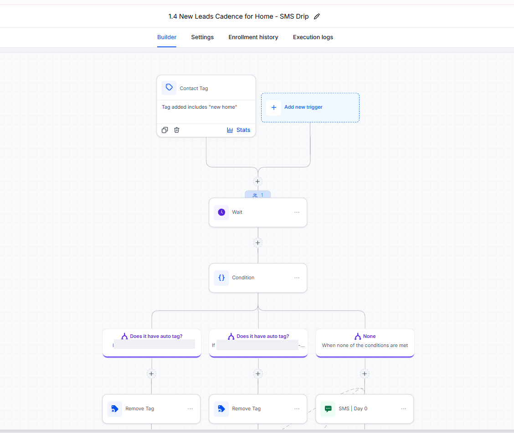
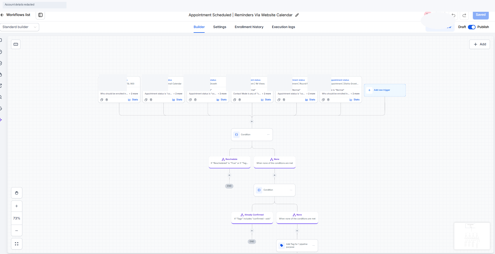

# Ian Keith Escabarte

### GoHighLevel Specialist | CRM Automation | Funnel & Landing Page Developer | Account Management

**4 Years of GoHighLevel Experience | Workflow Automation | CRM Implementation | Landing Page Development**

Welcome to my professional GoHighLevel portfolio!

I specialize in building, managing, and optimizing GoHighLevel CRM systems, automated workflows, and landing pages that help businesses streamline operations, manage leads, improve customer communication, and support business growth.

---

## About Me

I am a GoHighLevel Specialist with **4 years of hands-on experience** supporting businesses through CRM administration, workflow automation, funnel development, and client management.

### Professional Experience

**Alcohol Free Lifestyle — 3 Years**
- Executive Virtual Assistant and GoHighLevel support
- CRM management and administrative operations
- Customer communication and lead management
- Business process and operational support

**Active Solutions AI — 1 Year**
- GoHighLevel implementation and automation support
- Workflow configuration and CRM management
- Automation troubleshooting and quality assurance
- Business process optimization and implementation documentation

My additional professional background includes customer support, quality assurance, reporting, data management, and administrative operations.

---

## Core GoHighLevel Skills

- CRM and Account Management
- Workflow Automation and Conditional Logic
- Sales Pipelines and Opportunity Management
- Lead Nurturing and Reactivation
- SMS and Email Follow-up Automation
- Appointment Scheduling and Reminders
- Funnel and Landing Page Development
- GoHighLevel Website Builder
- Contact Tags and Custom Fields
- Internal Notifications and Task Automation
- Workflow Troubleshooting and Quality Assurance
- Client Communication and Account Support

---

## Featured GoHighLevel Automation Projects

### 01. X-Date Tracking & Reactivation

**Objective:** Support lead follow-up and reactivation using date-based conditions, opportunity updates, and assigned-owner routing.

**Additional Workflow Screenshots**
- [Opportunity Management](screenshots/X-Date_Tracking_Reactivation_2.png)
- [X-Date Conditions](screenshots/X-Date_Tracking_Reactivation_3.png)
- [Owner Routing and Follow-up](screenshots/X-Date_Tracking_Reactivation_4.png)

**Skills Demonstrated:** Conditional logic, date-based automation, opportunity updates, assigned-owner routing, internal notifications, and lead reactivation.

---

### 02. Quoted Hot Leads Follow-up

**Objective:** Coordinate automated sales follow-up for quoted leads through assigned-user routing and scheduled workflow actions.

**Additional Workflow Screenshots**
- [Assigned Owner Routing](screenshots/Quoted_Hot_Leads_2_Anonymized.png)
- [Timed Follow-up and PowerList Automation](screenshots/Quoted_Hot_Leads_3_Anonymized.png)

**Skills Demonstrated:** Lead management, workflow conditions, internal notifications, wait steps, sales follow-up, and PowerList management.

---

### 03. New Leads SMS Drip Campaign

**Objective:** Support automated lead nurturing through a multi-day SMS follow-up sequence with reply detection, contact segmentation, and DND handling.

**Additional Workflow Screenshots**
- [Initial SMS and Reply Detection](screenshots/New_Leads_SMS_Drip_2_Anonymized.png)
- [Early Follow-up Sequence](screenshots/New_Leads_SMS_Drip_3_Anonymized.png)
- [Conditional Routing](screenshots/New_Leads_SMS_Drip_4_Anonymized.png)
- [Extended Lead Nurturing](screenshots/New_Leads_SMS_Drip_5_Anonymized.png)
- [Final Follow-up and Lead Status](screenshots/New_Leads_SMS_Drip_6_Anonymized.png)

**Skills Demonstrated:** SMS drip campaigns, lead nurturing, reply detection, DND handling, wait conditions, tags, and opportunity management.

---

### 04. Appointment Scheduling & Reminder Automation

**Objective:** Support appointment confirmations, scheduled reminders, and CRM opportunity management through calendar-based workflow automation.

**Additional Workflow Screenshots**
- [Opportunity Management and Routing](screenshots/Appointment_Reminders_2_Anonymized.png)
- [Confirmation and Reminder Branches](screenshots/Appointment_Reminders_3_Anonymized.png)
- [Multi-Step Reminder Automation](screenshots/Appointment_Reminders_4_Anonymized.png)
- [Conditional Confirmation Handling](screenshots/Appointment_Reminders_5_Anonymized.png)
- [Extended Follow-up Logic](screenshots/Appointment_Reminders_6_Anonymized.png)

**Skills Demonstrated:** Appointment automation, calendar-based workflows, confirmation sequences, conditional branching, tags, scheduled reminders, and opportunity management.

---

## GoHighLevel Landing Pages & Website Projects

In addition to CRM automation, I have hands-on experience personally building landing pages and websites using GoHighLevel.

The following projects demonstrate my experience with the GoHighLevel page builder across different business industries.

### 01. GoHighLevel Landing Page

**Platform:** GoHighLevel / LeadConnector

**My Role:** Landing Page Developer

**Project Overview:** Built a landing page using the GoHighLevel page builder.

[View Live Preview](https://sites.leadconnectorhq.com/preview/1noZ1kwQVMf6Im3ISo0y)

---

### 02. Dash2Capital Website

**Industry:** Finance

**Platform:** GoHighLevel

**My Role:** Website Developer

**Project Overview:** Built a website for Dash2Capital using GoHighLevel.

[View Website](https://www.dash2capital.com/)

---

### 03. Dr. Natalie Love Coach Landing Page

**Industry:** Coaching

**Platform:** GoHighLevel

**My Role:** Landing Page Developer

**Project Overview:** Built a coaching-focused landing page using GoHighLevel.

[View Landing Page](https://discover.drnatalielovecoach.com/home---new-page)

---

### 04. Pink Roofing Free Estimate Landing Page

**Industry:** Roofing / Home Services

**Platform:** GoHighLevel

**My Role:** Landing Page Developer

**Project Overview:** Built a free-estimate landing page for a roofing services business using GoHighLevel.

[View Landing Page](https://pinkroofingil.com/freeestimate-4367)

---

## Additional Tools & Platforms

GoHighLevel | Zendesk | Shopify | Google Workspace | Microsoft Excel | Microsoft Office | Slack | Calendly | Canva | Zapier | Hubspot | IDX

---

## Professional Strengths

- Attention to detail and quality assurance
- CRM data management and organization
- Technical troubleshooting and problem-solving
- Client communication and account support
- Workflow documentation and process improvement
- Adaptability and continuous learning

---

## Career Opportunities

I am open to full-time opportunities in the following roles:

- GoHighLevel Specialist
- GHL Implementation Specialist
- CRM Automation Specialist
- GoHighLevel Account Manager
- GoHighLevel Funnel & Landing Page Developer

My goal is to help businesses maximize their GoHighLevel platform through reliable automation, organized CRM systems, and effective digital business solutions.

---

*Portfolio screenshots are anonymized demonstrations of workflow configuration. They do not independently establish live execution, message delivery, or testing results. Client projects are showcased with appropriate sharing authorization.*
