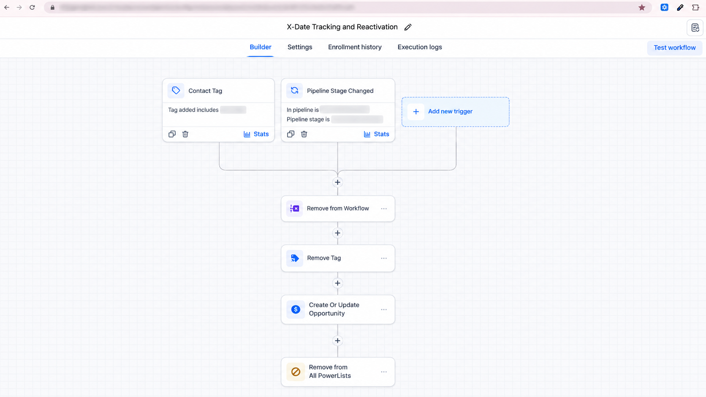
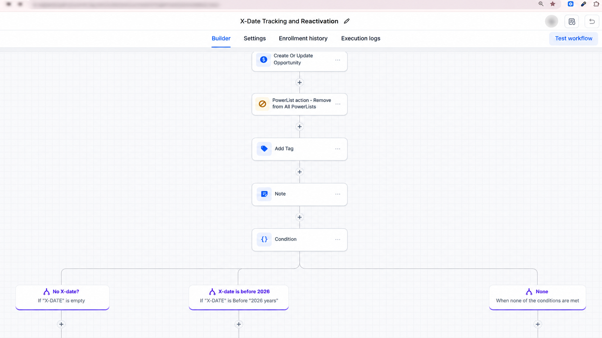
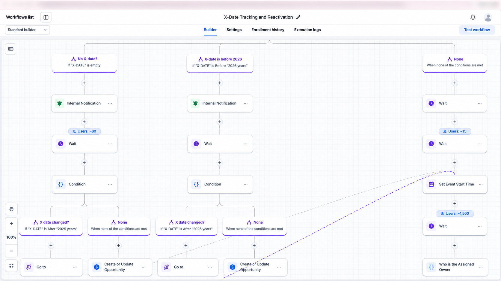
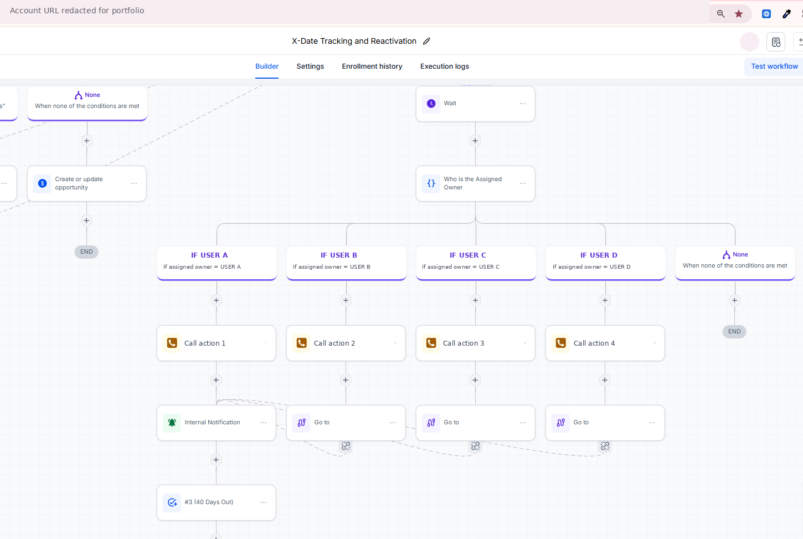
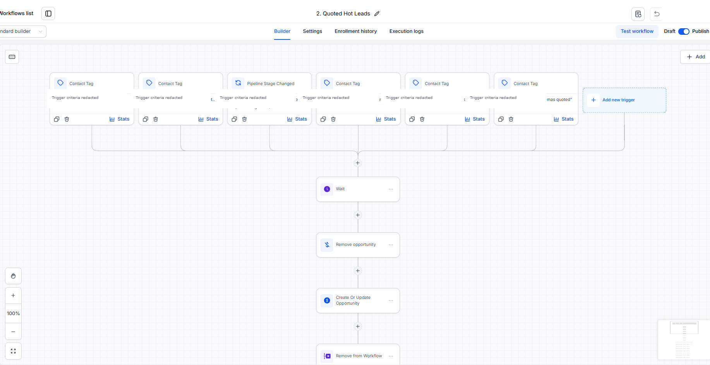
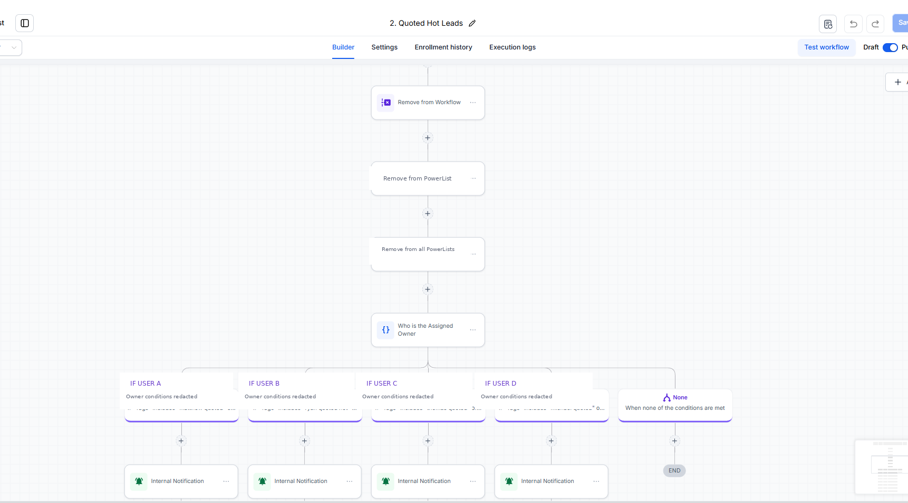
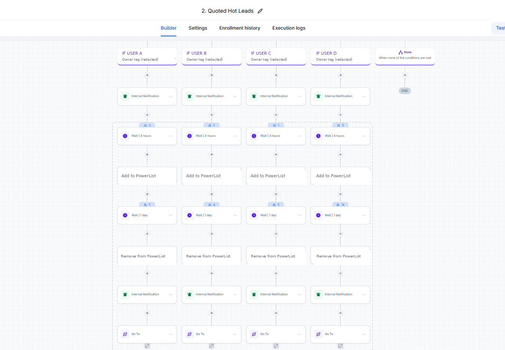

# go-highlevel-automation-portfolio
# Ian Keith Escabarte
### GoHighLevel Specialist | CRM Automation | Account Management

**4 Years of GoHighLevel Experience | Workflow Automation | CRM Implementation | Lead Management**

Welcome to my professional GoHighLevel portfolio!

I specialize in building, managing, and optimizing CRM systems and automated workflows that help businesses streamline operations, manage leads, and improve customer communication.

## About Me

I am a GoHighLevel Specialist with 4 years of experience:
- **Alcohol Free Lifestyle — 3 years:** Executive Virtual Assistant and GHL support
- **Active Solutions AI — 1 year:** GoHighLevel implementation and automation support

My additional experience includes quality assurance, customer support, reporting, administrative operations, and client communication.

## Core Skills

- GoHighLevel CRM and Account Management
- Workflow Automation and Conditional Logic
- Sales Pipelines and Opportunity Management
- Lead Nurturing and Reactivation
- SMS and Email Follow-up Automation
- Appointment Booking and Reminder Workflows
- Tags, Custom Fields, and Contact Segmentation
- Internal Notifications and Task Management
- Workflow Troubleshooting and Quality Assurance

## Featured GoHighLevel Projects

### 1. X-Date Tracking and Reactivation
A follow-up automation featuring assigned-user routing, call tasks, internal notifications, and scheduled follow-up actions.
#### Workflow Screenshots

**1. Workflow Triggers and Initial Configuration**

**2. Opportunity Management and Workflow Conditions**

**3. X-Date Validation and Conditional Routing**

**4. Assigned Owner Routing and Follow-up Actions**

**Skills demonstrated:** GoHighLevel workflow automation, conditional logic, X-Date tracking, opportunity management, internal notifications, wait steps, assigned-user routing, and lead reactivation.

### 2. Quoted Hot Leads Follow-up
A sales follow-up workflow featuring owner-specific branches, timed actions, Powerlist management, and internal notifications.

#### Workflow Screenshots

**1. Lead Qualification Triggers and Opportunity Management**

**2. Assigned Owner Routing and Internal Notifications**

**3. Timed Follow-up and PowerList Automation**

**Skills demonstrated:** GoHighLevel CRM automation, lead management, pipeline automation, assigned-owner routing, conditional logic, internal notifications, timed follow-up, and PowerList management.

*These screenshots demonstrate workflow configuration; live execution and testing results are not shown.*

### 3. New Leads SMS Drip Campaign
A multi-day SMS follow-up workflow with reply detection, DND conditions, and opportunity updates.

### 4. Appointment Scheduling and Reminder Automation
An appointment management workflow with confirmations, timed reminders, conditional branches, contact tags, and opportunity updates.

### 5. Reschedule Requested Follow-up
An automation for rescheduling inquiries using opportunity stage triggers, personalized messages, and internal notifications.

*Project screenshots and detailed case studies will be added after confidentiality review.*

## Tools and Platforms

GoHighLevel | Zendesk | Shopify | Google Workspace | Microsoft Excel | Slack | Calendly | Canva | Zapier | Hubspot | Kixie | IDX

## Professional Focus

Open to opportunities as a **GoHighLevel Specialist, GHL Account Manager, CRM Automation Specialist, or GHL Implementation Specialist**.

---
*Portfolio examples are shared for demonstration purposes. Confidential client information is excluded.*
